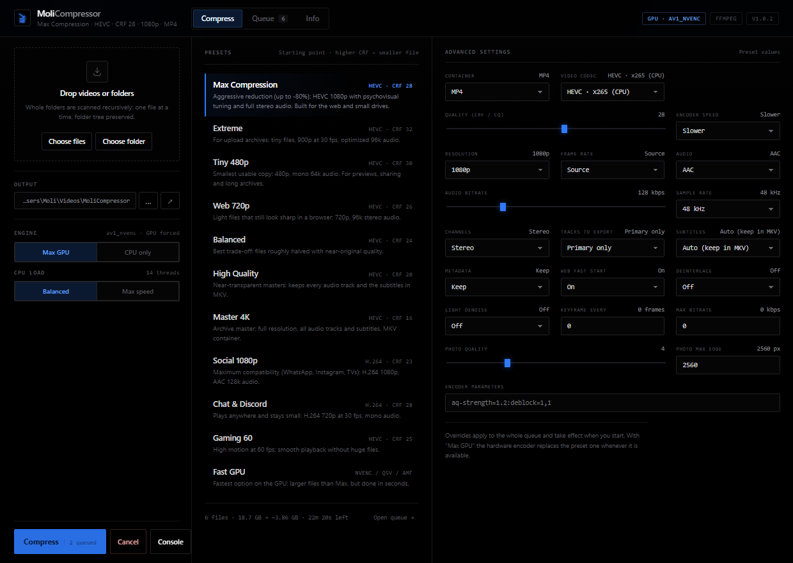
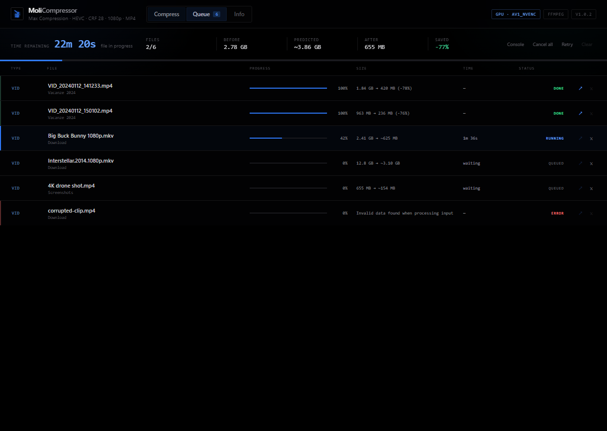
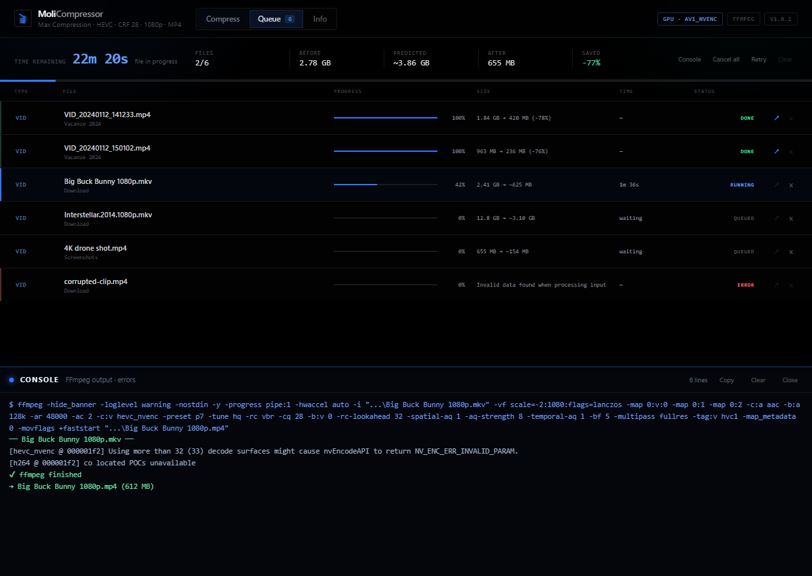
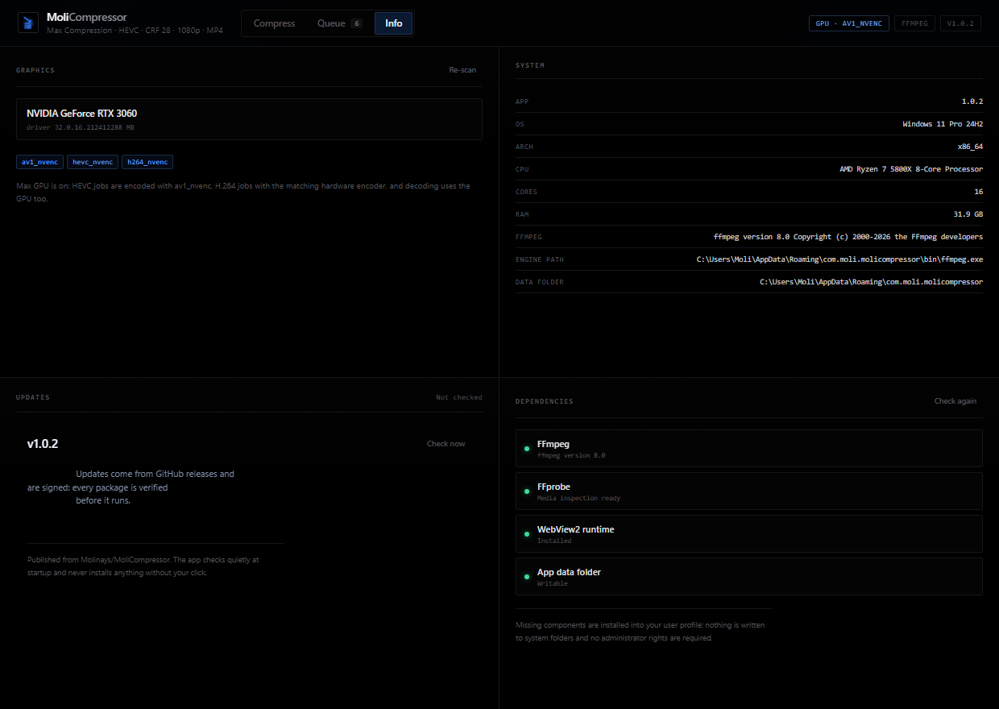

# MoliCompressor

**Batch video & photo compressor for Windows and Linux.** Drop a folder, pick a preset, and every
file is encoded one at a time with a real progress bar, an ETA and a predicted final size. The GPU
does the encoding whenever the machine has one.



> MoliCompressor is **proprietary software**. The source is published for transparency; it is not
> open source. See [LICENSE](LICENSE).

## What it does

- **Presets that actually look good.** 11 tuned presets from *Max Compression* (up to −80%) to
  *Master 4K* (near-transparent archive). They never touch your source files and you can override
  any single setting without editing a preset.
- **GPU first.** With *Max GPU* the encoder of the preset is replaced by the hardware encoder of the
  same family (NVENC / QSV / AMF), with a quality tuning measured against x265. If the GPU decoder
  fails on a file, that file is retried in software instead of failing.
- **Queue you can control.** Per-file progress, ETA per file and for the whole queue, predicted
  final size, cancel a single file or the whole queue, retry failures, folder tree preserved.
- **Audio like a real encoder.** Primary track, all tracks, **all tracks mixed into one**, or only
  the tracks you list (`1,3`). Plus codec, bitrate, sample rate and channel layout.
- **Subtitles, metadata, fast start, deinterlace, denoise, keyframe interval, bitrate cap.**
- **Photos too.** JPEG, PNG and WebP with quality and max-edge control.
- **Console when something breaks.** One button shows the exact FFmpeg command, its output and the
  error that made a file fail.
- **Self-updating.** Signed releases from GitHub; the app checks quietly at startup and installs only
  when you click.
- **Portable or installed.** One `.exe` next to FFmpeg, or an NSIS installer for the current user.

## Queue



Every row shows before → predicted size, live percentage, remaining time and status. The × cancels
that single file and the queue moves on; **Cancel all** stops after killing the current encode.

## Console



The command line is logged in full, together with FFmpeg warnings and errors, so a failure can be
diagnosed without opening a terminal. `Copy` puts the whole session on the clipboard.

## Info & updates



GPU, driver, VRAM, CPU, RAM, FFmpeg version and paths; the dependency check can install FFmpeg into
your user profile (Windows) without administrator rights. The **Updates** card is the same updater
that runs silently at startup.

## Presets

| Preset | Codec | Quality | Resolution | Audio | Container |
| --- | --- | --- | --- | --- | --- |
| Max Compression | HEVC (x265) | CRF 28 | 1080p | AAC 128k stereo, primary | MP4 |
| Extreme | HEVC | CRF 32 | 900p @30 | AAC 96k stereo | MP4 |
| Tiny 480p | HEVC | CRF 30 | 480p @30 | AAC 64k mono | MP4 |
| Web 720p | HEVC | CRF 26 | 720p | AAC 96k stereo | MP4 |
| Balanced | HEVC | CRF 24 | source | AAC 160k, all tracks | MP4 |
| High Quality | HEVC | CRF 20 | source | AAC 192k, all tracks + subs | MKV |
| Master 4K | HEVC | CRF 16 | source | AAC 256k, all tracks + subs | MKV |
| Social 1080p | H.264 | CRF 23 | 1080p @30 | AAC 128k stereo | MP4 |
| Chat & Discord | H.264 | CRF 28 | 720p @30 | AAC 64k mono | MP4 |
| Gaming 60 | HEVC | CRF 25 | 1080p @60 | AAC 160k stereo | MP4 |
| Fast GPU | NVENC/QSV/AMF | CQ 26 | 1080p | AAC 128k stereo | MP4 |

The x265 presets use psychovisual tuning (`aq-mode=3`, `psy-rd`, `rdoq-level=2`, `bframes=8`) so a
high CRF removes bitrate instead of detail.

## Advanced settings

Everything is an override on top of the preset, applied to the whole queue at start:

| Group | Options |
| --- | --- |
| Container / codec | MP4, MKV, WEBM · x265, x264, VP9, hardware encoders |
| Video | CRF/CQ 14–40, encoder speed, resolution down to 360p, fps cap |
| Audio | AAC / Opus / copy / none, 64–320 kbps, 32/44.1/48 kHz, stereo/mono |
| Audio tracks | Primary only · All tracks · Merge all into one · Custom (`1,3`) |
| Extras | Subtitles (auto/keep/remove), metadata (keep/strip), fast start, deinterlace, light denoise, keyframe interval, max bitrate, raw encoder parameters |

## Install

**Windows** — download `MoliCompressor_<version>_x64-setup.exe` from
[Releases](https://github.com/Molinays/MoliCompressor/releases) (per-user install, no admin rights),
or the portable `MoliCompressor.exe` bundle. FFmpeg and FFprobe ship with the app.

**Linux** — download the `.AppImage`, `chmod +x` it and run. FFmpeg is bundled. The AppImage is also
the package the updater can replace in place; a distro package would have to be updated by the
distro.

## Updates

The updater endpoint is
`https://github.com/Molinays/MoliCompressor/releases/latest/download/latest.json`. Every package is
signed with minisign and verified before it runs, so a tampered download is rejected. See
[RELEASING.md](RELEASING.md) for the release procedure.

## Command line

The same executable works headless, which is handy for scripts and for checking a preset:

```bash
molicompressor --scan "D:/video"
molicompressor --estimate input.mkv --preset max --gpu force
molicompressor --compress input.mkv output.mp4 --preset quality --gpu force --audio-tracks merge
molicompressor --compress input.mkv output.mkv --preset max --audio-tracks custom --audio-select 1,3
molicompressor --presets
```

More flags (`--crf`, `--container`, `--encoder`, `--speed`, `--resolution`, `--fps`, `--audio`,
`--audio-bitrate`, `--subtitles`, `--params`) are listed by running the command with no arguments.

## Website

The marketing site lives in [`site/`](site/index.html) — a single static page (no build step, no
CDN): glass panels, particles, a CSS-3D cube and continuous animations that are not disabled by
`prefers-reduced-motion`. Open it locally, or enable **Settings → Pages → Source: GitHub Actions** to
publish it with `.github/workflows/pages.yml`.

## Documentation

- [User guide](docs/USER-GUIDE.md) — every screen and setting explained.
- [Building](docs/BUILDING.md) — toolchains, local builds, screenshots, CI.
- [Releasing](RELEASING.md) — versions, signing keys, GitHub release.

## License

Proprietary, all rights reserved. Free to download and use; not free to copy, modify or
redistribute. FFmpeg is a separate executable under its own license (LGPL/GPL) — see
[LICENSE](LICENSE).
